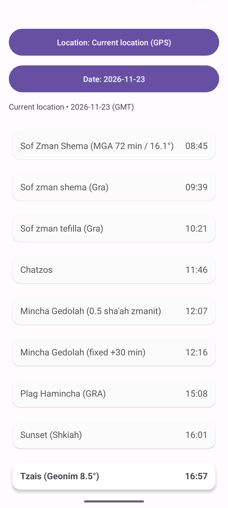
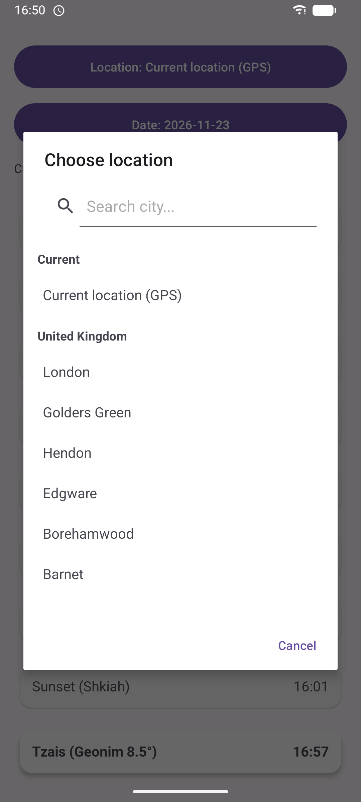
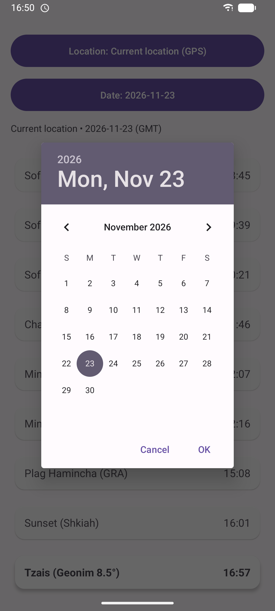
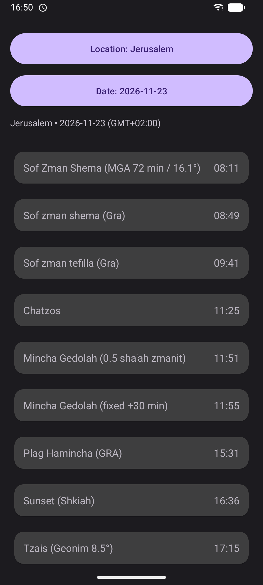

# Easy Zmanim

**A simple Android app that shows the day's halachic times (zmanim) for where you are, or for any of 110 cities worldwide, and highlights the next one coming up.**

*Currently in closed testing on Google Play.*

## Who it's for and the problem it solves

Observant Jews plan their day around zmanim: the latest time to say Shema, when Mincha can start, sunset, nightfall. These times change every day and depend on exactly where you are. Most zmanim apps pack in calendars, articles and settings, which makes it slow to answer the one thing you usually want to know: **what's the next zman, and when is it?**

Easy Zmanim opens straight to today's list for your current location, with the next upcoming time in bold and scrolled into view. If you're planning for another city (family abroad, an upcoming trip) you pick it from a searchable list, and the times are shown in **that city's own time zone**, not your phone's.

## Screenshots

| Today's zmanim (GPS, London) | Location picker | Date picker | Dark mode (Jerusalem) |
|---|---|---|---|
|  |  |  |  |

## Features

- **Current location via GPS.** Uses the Fused Location Provider, and asks for location permission only when you choose GPS mode.
- **110 preset cities in 10 regions** (UK, Israel, USA, Canada, Europe, Latin America, South Africa, Australia, Asia), loaded from a bundled JSON file.
- **Search box** that matches city names and region names, with aliases like `uk`, `us` and `usa`.
- **Correct time zone per city.** Times for New York show in New York time even when your phone is set to London.
- **Any date.** Pick a date to see past or future zmanim.
- **Next zman highlighted.** When viewing today, the next upcoming time is shown in bold, raised, and scrolled into view.
- **13 zmanim**, including the main alternative opinions:
  - Alos HaShachar (16.1°), Misheyakir (10.2°), Sunrise (Netz)
  - Sof Zman Shema (Magen Avraham 16.1° and GRA), Sof Zman Tefillah (GRA)
  - Chatzos, Mincha Gedolah (half a sha'ah zmanis, and a fixed 30 minutes), Plag HaMincha (GRA)
  - Sunset (Shkiah), Tzais (Geonim 8.5°)
- **Light and dark themes** that follow the system setting (Material 3 DayNight).
- **Calculated on the device.** No account and no server. Preset cities work fully offline.

## Tech stack

| Area | Choice |
|---|---|
| Language | Java 11 |
| Platform | Android, min SDK 26 (Android 8.0), target/compile SDK 36 |
| Build | Gradle 9.1 (wrapper), Android Gradle Plugin 9.0, version catalog (`gradle/libs.versions.toml`) |
| Zmanim calculations | [KosherJava Zmanim](https://github.com/KosherJava/zmanim) 2.5.0 |
| Location | Google Play Services Location 21.0.1 (Fused Location Provider) |
| UI | AndroidX AppCompat, Material Components 3, RecyclerView, CardView, DialogFragment |
| Dates and time zones | `java.time` (`LocalDate`, `ZoneId`, `ZonedDateTime`) |

### Project structure

```
app/src/main/
├── java/com/aricohen/easyzmanim/
│   ├── MainActivity.java          # Screen setup, GPS lookup, date picker, highlighting the next zman
│   ├── ZmanimService.java         # Wraps KosherJava: computes the ordered list of zmanim for a date and place
│   ├── ZmanimAdapter.java         # RecyclerView adapter for the zmanim cards
│   ├── ZmanRow.java               # Label + formatted time for one row
│   ├── LocationItem.java          # Header / City items for the location list
│   ├── LocationPickerDialog.java  # Searchable, grouped city picker
│   └── LocationPickerAdapter.java # Adapter for headers and cities in the picker
└── res/raw/locations.json         # 110 cities: name, latitude, longitude, IANA time zone
```

## Building and running

### Requirements

- [Android Studio](https://developer.android.com/studio) (a recent stable version that supports AGP 9.0)
- JDK 17 or newer (Android Studio's bundled JDK is fine)
- Android SDK Platform 36
- An emulator or Android device running Android 8.0 (API 26) or later. GPS mode needs Google Play services, so use an emulator image with the Play Store or Google APIs.

### In Android Studio

1. Clone the repo:
   ```bash
   git clone https://github.com/AriCohen1/easy-zmanim.git
   ```
2. In Android Studio choose **File → Open** and select the cloned folder. Android Studio creates `local.properties` with your SDK path automatically.
3. Wait for Gradle sync to finish, then press **Run ▶** with a device or emulator selected.

### From the command line

```bash
./gradlew assembleDebug
```

The APK is written to `app/build/outputs/apk/debug/app-debug.apk`. To build and install it on a connected device in one step:

```bash
./gradlew installDebug
```

To run the unit tests:

```bash
./gradlew test
```

> Release builds are signed with a private key that is **not** in this repository. Debug builds use Android's standard debug key and need no setup.

### Trying GPS mode on an emulator

Open the emulator's **Extended controls (⋯) → Location**, set a point, and choose **Current location (GPS)** in the app.

## Acknowledgements

Zmanim calculations use the [KosherJava Zmanim library](https://github.com/KosherJava/zmanim) by Eliyahu Hershfeld, licensed under the LGPL 2.1.

## Disclaimer

Times are calculated astronomically and are provided for convenience. Local conditions (elevation, terrain) and differing customs can affect them, so ask your rabbi for halachic guidance.

## Licence

[MIT](LICENSE) © 2026 Ari Cohen
